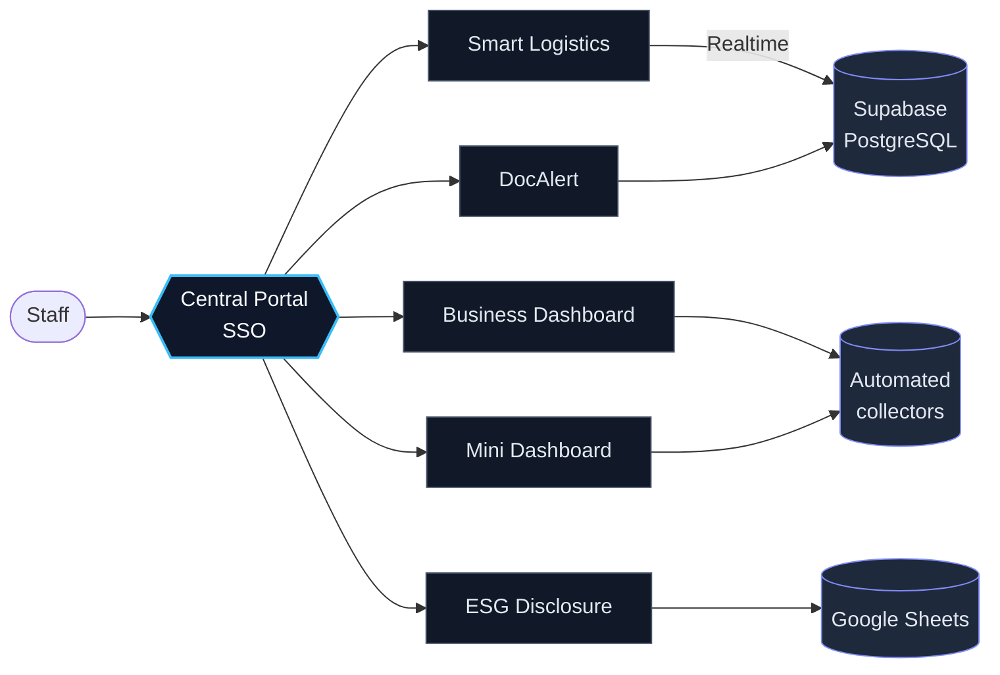
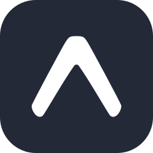

  

  

  
  
  

 

<table>
  <tr>
    <td width="50%" valign="top">
      <h3>About</h3>
      
Full-stack developer building the internal systems a manufacturing and logistics business runs on: transport planning, KPI dashboards, document workflows and ESG disclosure.

      
I care about systems that stay fast and cheap to run, ship in small safe steps through DEMO and PRD environments, and replace spreadsheets people have outgrown.

    </td>
    <td width="50%" valign="top">
      <h3>At a glance</h3>
      <table>
        <tr><td><b>6</b></td><td>production systems maintained</td></tr>
        <tr><td><b>230+</b></td><td>commits on one platform in Nov 2026</td></tr>
        <tr><td><b>1</b></td><td>central sign-on across every app</td></tr>
        <tr><td><b>3</b></td><td>branches visualized in a 3D yard view</td></tr>
      </table>
    </td>
  </tr>
</table>

## What I am building

Six systems under one company domain with a single sign-on portal in front. Five moved from Vercel to Cloudflare in November 2026.

| System | What it does | Built with |
|---|---|---|
| **Smart Logistics Platform** | Transport planning from sales orders, vehicle booking calendar, weighbridge ticket matching, shipment tracking | Cloudflare Workers, Supabase Realtime |
| **Central Portal (SSO)** | One sign-in and launcher for every internal app | Cloudflare Pages |
| **DocAlert** | Contract and document renewals with approvals and email alerts | Cloudflare Pages, Supabase |
| **Smart Business Dashboard** | Company KPIs, task-first navigation, collector health view | Cloudflare Pages |
| **Mini Business Dashboard** | Lightweight KPI view with role-based overrides | Cloudflare Pages |
| **ESG Disclosure Site** | Bilingual Thai / English ESG reporting across five categories | React, Vite, Google Sheets |

<b>Recent engineering notes from the Smart Logistics Platform</b>

 

- **Platform migration.** Moved DEMO and PRD from Vercel to Cloudflare Workers and Pages, including scheduled jobs, with the legacy app redirecting users to the new one.
- **Performance.** Replaced 30-second polling with Supabase Realtime, throttled shared-data refresh to once a minute, and batched notification queries into a single round trip.
- **Planning.** Plan directly from sales orders with over-quantity warnings, provisional loading dates and storage jobs that do not need an order.
- **Operations.** Automatic weighbridge ticket matching, per-trip shipment numbers with attachments, weekly summaries and bulk cancellation with reasons.
- **Security.** Least-privilege database role for the web app, access logging and rotated SSO secrets.

## Featured projects

<table>
  <tr>
    <td width="50%" valign="top">
      
      <h3>Smart Cow Tracker</h3>
      
Dairy farm management app with real-time health tracking, records, appointments and assistant management.

      
<code>React Native</code> <code>Expo</code> <code>Firebase</code>

      
<a href="https://youtu.be/uTIGElkRXKc">Demo video</a> · <a href="https://drive.google.com/file/d/1XQKEonFqFlDZqEPxyeqIkxalqGy50DhL/view?usp=drive_link">Poster</a>

    </td>
    <td width="50%" valign="top">
      
      <h3>PQS Logistics (v1)</h3>
      
The original planning and vehicle booking tool, with approvals and reports, that grew into the Smart Logistics Platform.

      
<code>Google Apps Script</code> <code>Google Sheets</code>

      
<a href="https://drive.google.com/file/d/1HeC-MrxZyF2orxr88V_linuolvKyxozl/view?usp=drive_link">Poster</a>

    </td>
  </tr>
</table>

## Tech stack

<table>
  <tr>
    <td width="150"><b>Languages</b></td>
    <td align="center" width="96"> TypeScript</td>
    <td align="center" width="96"> JavaScript</td>
    <td align="center" width="96"> Python</td>
    <td align="center" width="96"> PHP</td>
    <td align="center" width="96"> HTML</td>
    <td align="center" width="96"> CSS</td>
  </tr>
  <tr>
    <td width="150"><b>Frontend</b></td>
    <td align="center" width="96"> React</td>
    <td align="center" width="96"> Next.js</td>
    <td align="center" width="96"> Vite</td>
    <td align="center" width="96"> Tailwind CSS</td>
    <td align="center" width="96"> Angular</td>
    <td align="center" width="96"> Bootstrap</td>
  </tr>
  <tr>
    <td width="150"><b>Mobile</b></td>
    <td align="center" width="96"> React Native</td>
    <td align="center" width="96"> Expo</td>
  </tr>
  <tr>
    <td width="150"><b>Backend and Data</b></td>
    <td align="center" width="96"> Node.js</td>
    <td align="center" width="96"> Supabase</td>
    <td align="center" width="96"> PostgreSQL</td>
    <td align="center" width="96"> Firebase</td>
    <td align="center" width="96"> MySQL</td>
    <td align="center" width="96"> MongoDB</td>
  </tr>
  <tr>
    <td width="150"><b>Cloud and DevOps</b></td>
    <td align="center" width="96"> Cloudflare</td>
    <td align="center" width="96"> Vercel</td>
    <td align="center" width="96"> Git</td>
    <td align="center" width="96"> GitHub</td>
  </tr>
  <tr>
    <td width="150"><b>Automation and Tools</b></td>
    <td align="center" width="96"> Apps Script</td>
    <td align="center" width="96"> Google Sheets</td>
    <td align="center" width="96"> Postman</td>
    <td align="center" width="96"> Figma</td>
  </tr>
</table>

## Contact

  
  
  
  

